# Sprawozdanie z laboratorium nr 1

**Przedmiot:** Aplikacje w środowisku kontenerowym  
**Temat:** Pierwsze kroki z Dockerem  
**Data wykonania:** 26.10.2026  
**Autor:** Patrycja Teska  
**Numer indeksu:** 25935  
**Grupa:** 235IC, A2

---

## 1. Cel laboratorium

Celem laboratorium było poznanie podstaw Dockera oraz nauka pracy z obrazami i kontenerami. W trakcie ćwiczeń uruchamiano i zatrzymywano kontenery, wykonywano w nich polecenia oraz sprawdzano ich działanie. Przećwiczono także kopiowanie plików, przeglądanie logów i zarządzanie zasobami Dockera.

---

## 2. Wstęp teoretyczny

Docker to narzędzie, które pozwala uruchamiać aplikacje w odizolowanych środowiskach, nazywanych kontenerami. Obraz Dockera zawiera pliki i elementy potrzebne do uruchomienia aplikacji, a kontener jest tworzony na jego podstawie. Dzięki temu można korzystać z różnych programów bez instalowania ich bezpośrednio na komputerze.

---

## 3. Przebieg ćwiczeń

### Ćwiczenie 1.1 - Sprawdzenie wersji Dockera

**Opis:**

Na początku sprawdzono, czy Docker jest poprawnie zainstalowany na komputerze oraz jaka wersja programu jest dostępna.

**Użyte polecenia:**

```bash
docker --version
```

**Wynik działania:**

Docker version 29.8.0, build 88096ef.

**Screenshot:**


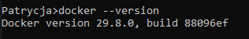

*Rysunek 1. Sprawdzenie wersji Dockera.*

---

### Ćwiczenie 1.2 - Uruchomienie pierwszego kontenera

**Opis:**

Uruchomiono pierwszy kontener z obrazem hello-world. Docker pobrał obraz i wyświetlił komunikat potwierdzający, że wszystko działa poprawnie.

**Użyte polecenia:**

```bash
docker run hello-world
```

**Wynik działania:**

Wyświetlono komunikat „Hello from Docker!”, który potwierdził poprawne działanie Dockera.

**Screenshot:**

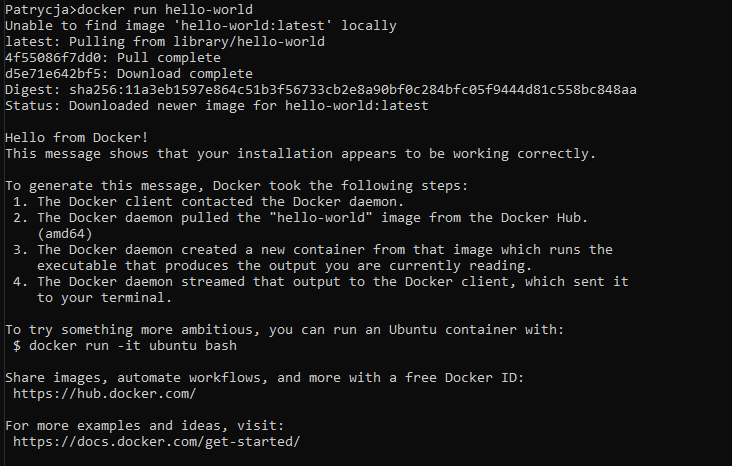

*Rysunek 2. Uruchomienie kontenera hello-world.*

---

### Ćwiczenie 2.1 - Wyświetlanie obrazów Dockera

**Opis:**

Sprawdzono listę obrazów Dockera dostępnych na komputerze. Wyświetlono ich nazwy, wersje oraz rozmiary.

**Użyte polecenia:**

```bash
docker images
```

**Wynik działania:**

Wyświetlono listę pobranych obrazów, m.in. Ubuntu, Alpine, Nginx i PostgreSQL.

**Screenshot:**


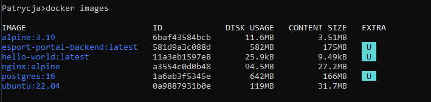

*Rysunek 3. Lista obrazów Dockera.*

---

### Ćwiczenie 2.2 - Porównanie rozmiarów obrazów

**Opis:**

Porównano rozmiary pobranych obrazów Dockera, aby sprawdzić, który z nich zajmuje najmniej miejsca.

**Wynik działania:**

Najmniejszym obrazem był hello-world (25,9 kB), ponieważ zawiera jedynie prosty program wyświetlający komunikat. Wśród obrazów systemowych najmniejszy był alpine:3.19 (11,6 MB), który zawiera tylko podstawowe narzędzia i pakiety.

---

### Ćwiczenie 3.1 - Uruchomienie interaktywnego kontenera Ubuntu

**Opis:**

Uruchomiono kontener Ubuntu w trybie interaktywnym. Następnie sprawdzono informacje o systemie, wykonano podstawowe polecenia oraz zainstalowano program curl.

**Użyte polecenia:**

```bash
docker run -it ubuntu:22.04 bash
cat /etc/os-release
whoami
hostname
ls
pwd
apt-get update && apt-get install -y curl
curl --version
Exit
```

**Wynik działania:**

Udało się uruchomić kontener Ubuntu, wykonać polecenia systemowe i sprawdzić wersję zainstalowanego programu curl.

**Odpowiedź na pytanie:**

**Odpowiedź na pytanie: Co stanie się z zainstalowanym curl po wyjściu z kontenera?**

- Program curl pozostanie w danym kontenerze, nawet po jego zatrzymaniu. Jeśli jednak kontener zostanie usunięty, zainstalowany program również zniknie. W nowym kontenerze utworzonym z tego samego obrazu trzeba będzie zainstalować go ponownie.

**Screenshot:**

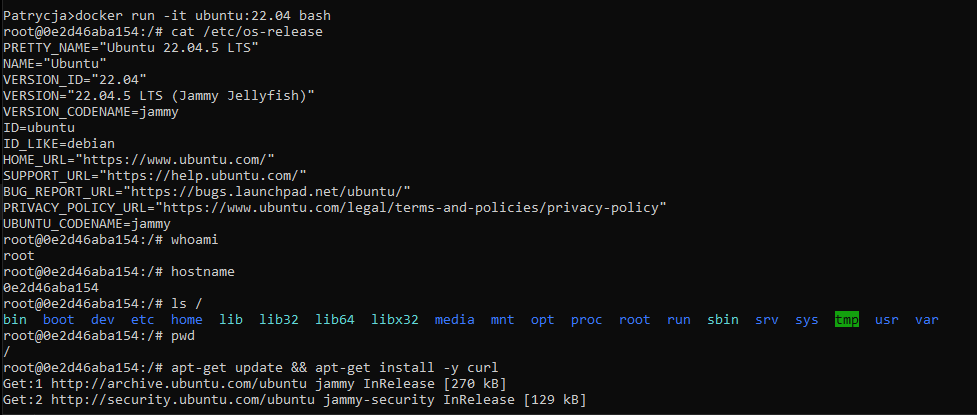

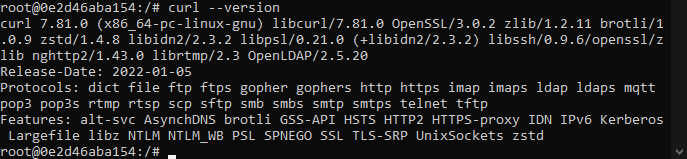

*Rysunek 4. Uruchomienie kontenera Ubuntu i sprawdzenie działania programu curl.*

---

### Ćwiczenie 3.2 - Uruchamianie kontenera w tle

**Opis:**

Uruchomiono kontener Nginx w trybie pracy w tle. Następnie sprawdzono, czy kontener działa poprawnie i jest widoczny na liście uruchomionych kontenerów.

**Użyte polecenia:**

```bash
docker run -d --name moj-nginx nginx:alpine
docker ps
```

**Wynik działania:**

Kontener moj-nginx został poprawnie uruchomiony i był widoczny na liście działających kontenerów.

**Screenshot:**

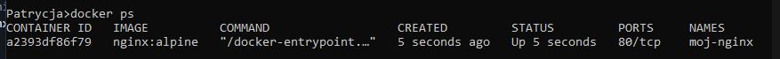

*Rysunek 5. Uruchomienie kontenera Nginx w tle.*

---

### Ćwiczenie 3.3 - Mapowanie portów

**Opis:**

Uruchomiono serwer Nginx w kontenerze Docker i udostępniono go na porcie 8080. Następnie otwarto stronę w przeglądarce, aby sprawdzić, czy serwer działa poprawnie.

**Użyte polecenia:**

```bash
docker run -d --name moj-nginx -p 8080:80 nginx:alpine
```

**Wynik działania:**

Po wpisaniu adresu http://localhost:8080 w przeglądarce wyświetliła się strona powitalna Nginx, co potwierdziło poprawne działanie serwera.

**Screenshot:**

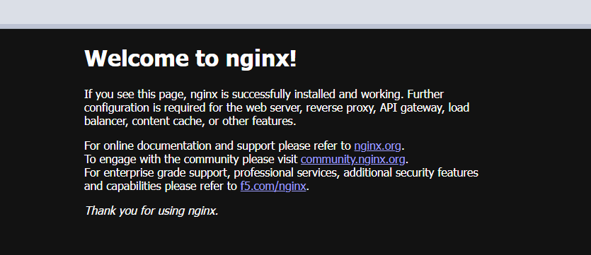

*Rysunek 6. Sprawdzenie działania serwera Nginx w przeglądarce.*

---

### Ćwiczenie 3.4 - Uruchomienie bazy danych MySQL

**Opis:**

Uruchomiono kontener z bazą danych MySQL, ustawiono hasło użytkownika oraz utworzono bazę testdb. Następnie połączono się z MySQL i sprawdzono listę dostępnych baz danych.

**Użyte polecenia:**

```bash
docker run -d --name moj-mysql -e MYSQL_ROOT_PASSWORD=mojehaslo -e MYSQL_DATABASE=testdb -p 3306:3306 mysql/mysql-server:8.0
docker exec -it moj-mysql mysql -u root -pmojehaslo -e "SHOW DATABASES;"
```

**Wynik działania:**

Połączenie z MySQL zakończyło się poprawnie. Wyświetlono listę baz danych, na której znajdowała się również utworzona baza testdb.

**Screenshot:**

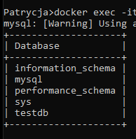

*Rysunek 7. Uruchomienie bazy danych MySQL i wyświetlenie dostępnych baz.*

---

### Ćwiczenie 4.2 - Wykonywanie poleceń w działającym kontenerze

**Opis:**

Uruchomiono kontener Ubuntu, a następnie za pomocą polecenia docker exec wykonano w nim dodatkowe komendy. Sprawdzono informacje o systemie oraz działające procesy. Użyto również polecenia docker top.

**Użyte polecenia:**

```bash
docker run -d --name moj-ubuntu ubuntu:22.04 sleep 3600
docker exec moj-ubuntu cat /etc/os-release
docker exec -it moj-ubuntu bash
docker top moj-ubuntu
```

**Wynik działania:**

Polecenia zostały wykonane poprawnie. Wyświetlono informacje o systemie Ubuntu oraz listę procesów uruchomionych w kontenerze.

**Screenshot:**

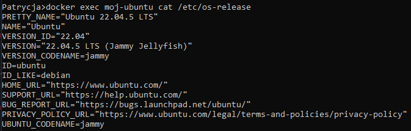

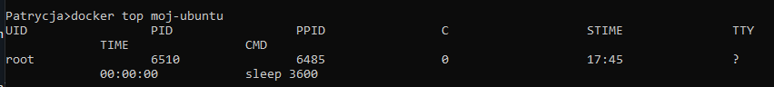

*Rysunek 8. Wykonywanie poleceń wewnątrz kontenera i sprawdzanie uruchomionych procesów.*

---

### Ćwiczenie 4.3 - Kopiowanie plików między komputerem a kontenerem

**Opis:**

Sprawdzono możliwość kopiowania plików między komputerem a działającym kontenerem Docker. Za pomocą polecenia docker cp przeniesiono plik do kontenera, a następnie skopiowano inny plik z kontenera na komputer.

**Użyte polecenia:**

```bash
echo "Witaj z hosta!" > plik-z-hosta.txt
docker cp plik-z-hosta.txt moj-ubuntu:/tmp/
docker exec moj-ubuntu cat /tmp/plik-z-hosta.txt
docker exec moj-ubuntu bash -c "echo 'Witaj z kontenera' > /tmp/plik-z-kontenera.txt"
docker cp moj-ubuntu:/tmp/plik-z-kontenera.txt ./
type plik-z-kontenera.txt
```

**Wynik działania:**

Pliki zostały poprawnie skopiowane w obie strony. Ich zawartość sprawdzono za pomocą poleceń w terminalu.

**Screenshot:**

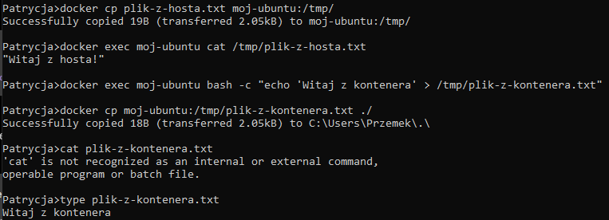

*Rysunek 9. Kopiowanie plików między komputerem a kontenerem za pomocą polecenia docker cp.*

---

### Ćwiczenie 4.5 - Monitorowanie zasobów kontenerów

**Opis:**

Uruchomiono dwa kontenery Nginx, a następnie sprawdzono ich wykorzystanie zasobów za pomocą polecenia docker stats. Pozwoliło to zobaczyć między innymi zużycie pamięci RAM i procesora przez działające kontenery.

**Użyte polecenia:**

```bash
docker run -d --name web1 nginx:alpine
docker run -d --name web2 nginx:alpine
docker stats
docker stats --no-stream
```

**Wynik działania:**

Wyświetlono informacje o zużyciu zasobów przez kontenery, w tym wykorzystanie procesora i pamięci RAM.

**Screenshot:**

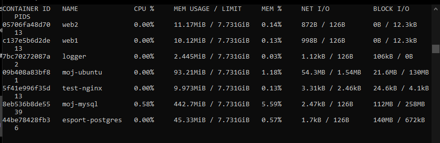

*Rysunek 10. Monitorowanie zużycia zasobów przez kontenery Docker.*

---

### Ćwiczenie 5.1 - Sprawdzanie szczegółowych informacji o kontenerze

**Opis:**

Uruchomiono kontener Nginx, a następnie za pomocą polecenia docker inspect sprawdzono szczegółowe informacje na jego temat, między innymi adres IP.

**Użyte polecenia:**

```bash
docker run -d --name inspect-test -p 9090:80 nginx:alpine
docker inspect inspect-test
docker inspect -f "{{range .NetworkSettings.Networks}}{{.IPAddress}}{{end}}" inspect-test
```

**Wynik działania:**

Wyświetlono szczegółowe informacje o kontenerze. Odczytano również jego adres IP: 172.17.0.8.

**Screenshot:**

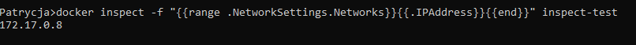

*Rysunek 11. Sprawdzenie szczegółowych informacji o kontenerze i jego adresu IP za pomocą polecenia docker inspect.*

---

### Ćwiczenie 5.2 - Sprawdzanie zmian w kontenerze

**Opis:**

W kontenerze Ubuntu utworzono nowe pliki oraz usunięto jeden z istniejących. Następnie za pomocą polecenia docker diff sprawdzono zmiany w systemie plików kontenera.

**Odpowiedź na pytanie:**

- A (Added) – dodany plik lub katalog.
- C (Changed) – zmodyfikowany plik lub katalog.
- D (Deleted) – usunięty plik lub katalog.

---

### Ćwiczenie 6.1 - Czyszczenie zasobów Dockera

**Opis:**

Sprawdzono ilość miejsca zajmowanego przez obrazy i kontenery Dockera. Następnie usunięto niepotrzebne kontenery utworzone podczas laboratorium i ponownie sprawdzono wykorzystanie zasobów.

**Użyte polecenia:**

```bash
docker system df
docker image prune -f
docker system df
```

**Wynik działania:**

Usunięto niepotrzebne kontenery, zmniejszając liczbę kontenerów z 13 do 2. Pozostawiono kontenery związane z innym projektem. Ponowne sprawdzenie zasobów potwierdziło wykonanie czyszczenia.

**Screenshot:**

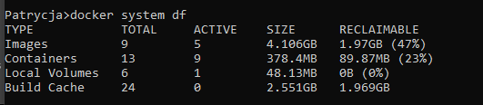

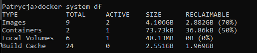

*Rysunek 12. Porównanie wykorzystania zasobów Dockera przed czyszczeniem i po czyszczeniu.*

---

### Zadania samodzielne

### Zadanie 1 - Uruchomienie serwera Apache

**Opis:**

Uruchomiono serwer Apache w kontenerze Docker i udostępniono go na porcie 8888. Następnie sprawdzono jego działanie w przeglądarce internetowej.

**Użyte polecenia:**

```bash
docker run -d --name moj-apache -p 8888:80 httpd:alpine
```

**Wynik działania:**

Po wpisaniu adresu http://localhost:8888 w przeglądarce wyświetliła się strona z komunikatem „It works!”, co potwierdziło poprawne działanie serwera Apache.

**Screenshot:**

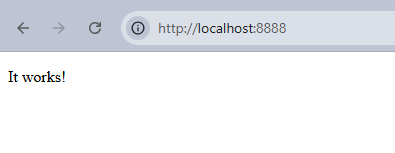

*Rysunek 13. Uruchomienie serwera Apache w kontenerze Docker i sprawdzenie jego działania w przeglądarce.*

---

### Zadanie 2 - Uruchomienie bazy danych PostgreSQL

**Opis:**

Uruchomiono kontener z bazą danych PostgreSQL i utworzono bazę uczelnia. Następnie połączono się z bazą, utworzono tabelę studenci i sprawdzono, czy została poprawnie zapisana.

**Użyte polecenia:**

```bash
docker run -d --name postgres-uczelnia -e POSTGRES_USER=student -e POSTGRES_PASSWORD=student123 -e POSTGRES_DB=uczelnia -p 5433:5432 postgres:16
docker exec -it postgres-uczelnia psql -U student -d uczelnia
```

**Polecenie SQL / sprawdzenie tabeli:**

```sql
CREATE TABLE studenci (
id SERIAL PRIMARY KEY,
imie VARCHAR(50),
nazwisko VARCHAR(50)
);
\dt
```

**Wynik działania:**

Baza danych została poprawnie uruchomiona. Utworzono tabelę studenci, która pojawiła się na liście tabel w bazie uczelnia.

**Screenshot:**

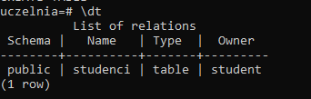

*Rysunek 14. Uruchomienie bazy danych PostgreSQL i utworzenie tabeli studenci.*

---

### Zadanie 3 - Uruchomienie Pythona w kontenerze Docker

**Opis:**

Uruchomiono kontener z Pythonem, a następnie sprawdzono jego wersję i zainstalowano bibliotekę requests. Wykonano również prosty skrypt, aby sprawdzić poprawność działania biblioteki.

**Użyte polecenia:**

```bash
docker run --rm -it python:3.11-slim bash
python --version
pip install requests
python skrypt.py
```

**Wynik działania:**

Python działał poprawnie w kontenerze. Wyświetlono wersję Python 3.11.17, a biblioteka requests została pomyślnie zainstalowana i przetestowana.

**Screenshot:**

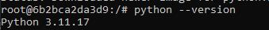

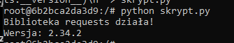

*Rysunek 15. Sprawdzenie wersji Pythona oraz instalacja i weryfikacja biblioteki requests w kontenerze Docker.*

---

### Zadanie 4 - Porównanie rozmiarów obrazów Pythona

**Opis:**

Pobrano trzy wersje obrazu Pythona: standardową, slim oraz alpine. Następnie porównano ich rozmiary za pomocą polecenia docker images.

**Użyte polecenia:**

```bash
docker pull python:3.11
docker pull python:3.11-slim
docker pull python:3.11-alpine
docker images python
```

**Wynik działania:**

Porównano rozmiary pobranych obrazów: python:3.11 – 1,62 GB python:3.11-slim – 189 MB python:3.11-alpine – 84,6 MB Najmniejszy okazał się obraz alpine, a największy standardowy obraz Pythona. Wersje slim i alpine zajmują mniej miejsca, ponieważ zawierają mniej dodatkowych pakietów i narzędzi.

**Screenshot:**

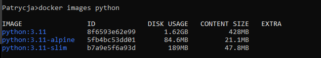

*Rysunek 16. Porównanie rozmiarów obrazów Python 3.11, Python 3.11-slim oraz Python 3.11-alpine.*

---


## 6. Wnioski

Podczas laboratorium nauczyłam się podstawowych poleceń Dockera i pracy z kontenerami. Większość zadań udało mi się wykonać bez większych problemów. Ćwiczenia pomogły mi lepiej zrozumieć, jak działa Docker i jak można z niego korzystać.