# Sprawozdanie z laboratorium nr 2

**Przedmiot:** Aplikacje w środowisku kontenerowym  
**Temat:** Budowanie obrazów z Dockerfile  
**Data wykonania:** 02.11.2026  
**Autor:** Patrycja Teska  
**Numer indeksu:** 25935  
**Grupa:** 235IC, A2

---

## 1. Cel laboratorium

Celem laboratorium było nauczenie się tworzenia własnych obrazów Dockera za pomocą plików Dockerfile. W trakcie ćwiczeń sprawdzono działanie podstawowych instrukcji, zmiennych środowiskowych oraz mechanizmu cache. Przećwiczono również budowanie obrazów wieloetapowych, zmniejszanie ich rozmiaru i publikowanie na Docker Hub.

---

## 2. Wstęp teoretyczny

Dockerfile to plik z instrukcjami, według których Docker buduje obraz aplikacji. Pozwala określić między innymi obraz bazowy, pliki do skopiowania, potrzebne biblioteki i polecenie uruchamiające program. Dzięki multi-stage build można podzielić budowanie na etapy i pozostawić w końcowym obrazie tylko potrzebne elementy. Plik `.dockerignore` pozwala natomiast pominąć niepotrzebne pliki podczas budowania.

---

## 3. Przebieg ćwiczeń

### Ćwiczenie 1.1 - Prosty obraz z Pythonem

**Opis:**

Utworzono prosty skrypt `app.py` wyświetlający informacje o Pythonie i systemie. Następnie przygotowano Dockerfile, zbudowano obraz i uruchomiono kontener.

**Użyte polecenia:**

```bash
docker build -t hello-python:v1 .
docker run --rm hello-python:v1
```

**Wynik działania:**

Obraz `hello-python:v1` został zbudowany, a uruchomiony kontener wyświetlił informacje o środowisku oraz napis „Witaj z kontenera Docker!”.

**Screenshot:**

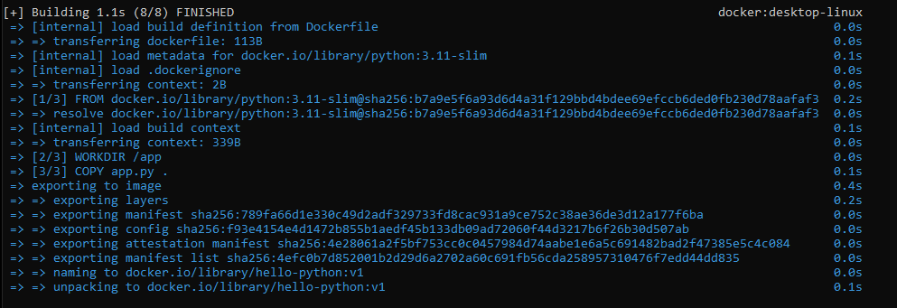

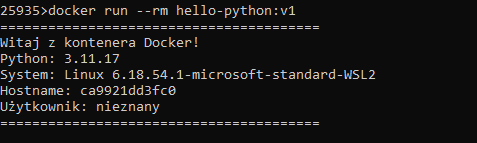

*Rysunek 1. Budowanie i uruchomienie pierwszego obrazu z Pythonem.*

---

### Ćwiczenie 1.2 - Analiza warstw obrazu

**Opis:**

Sprawdzono historię warstw zbudowanego obrazu oraz jego rozmiar.

**Użyte polecenia:**

```bash
docker history hello-python:v1
docker images hello-python
```

**Wynik działania:**

Wyświetlono warstwy obrazu i informacje o jego rozmiarze.

---

### Ćwiczenie 1.3 - Obraz z zależnościami

**Opis:**

Przygotowano aplikację Flask oraz plik `requirements.txt` z bibliotekami. Zbudowano obraz i uruchomiono aplikację na porcie 5000.

**Użyte polecenia:**

```bash
docker build -t flask-app:v1 .
docker run -d --name flask-test -p 5000:5000 flask-app:v1
curl http://localhost:5000
curl http://localhost:5000/health
```

**Wynik działania:**

Aplikacja otworzyła się pod adresem `http://localhost:5000`. Endpoint `/health` zwrócił odpowiedź `{"status":"ok"}`.


**Screenshot:**

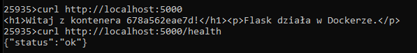

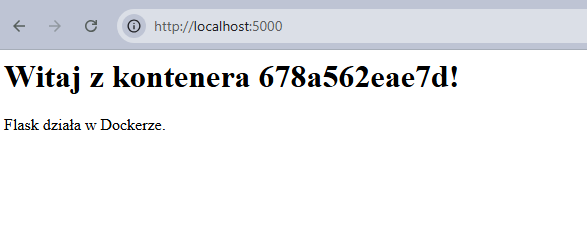

*Rysunek 2. Budowanie obrazu i uruchomienie aplikacji Flask w kontenerze Docker.*


---

### Ćwiczenie 2.1 - WORKDIR, COPY, ADD

**Opis:**

Przygotowano foldery z plikami programu i konfiguracji oraz archiwum. Następnie sprawdzono kopiowanie plików i rozpakowywanie archiwum za pomocą instrukcji `COPY` i `ADD`.

**Użyte polecenia:**

```bash
docker build -t workdir-test .
docker run --rm workdir-test
```

**Wynik działania:**

Obraz zbudował się poprawnie, a kontener wyświetlił komunikat `Hello from src`.

---

### Ćwiczenie 2.2 - ENV i ARG

**Opis:**

Zastosowano zmienne środowiskowe `ENV` i argumenty budowania `ARG`. Sprawdzono różnicę między wartościami domyślnymi a podanymi podczas uruchamiania kontenera.

**Użyte polecenia:**

```bash
docker build --build-arg BUILD_DATE=%DATE% -t env-test:v1 .
docker run --rm env-test:v1
docker run --rm -e ENVIRONMENT=development -e DEBUG=true env-test:v1
```

**Wynik działania:**

W pierwszym uruchomieniu wyświetlono `ENVIRONMENT: production` i `DEBUG: brak`, a w drugim `ENVIRONMENT: development` i `DEBUG: true`.

**Screenshot:**

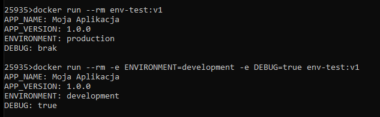

*Rysunek 3. Porównanie domyślnych i nadpisanych zmiennych środowiskowych.*

---

### Ćwiczenie 2.3 - CMD vs ENTRYPOINT

**Opis:**

Zbudowano dwa obrazy i porównano działanie instrukcji `CMD` oraz `ENTRYPOINT` podczas podawania dodatkowych argumentów.

**Użyte polecenia:**

```bash
docker build -t greet-cmd .
docker run --rm greet-cmd
docker run --rm greet-cmd echo "nadpisane"
docker build -t greet-entry -f Dockerfile.entry .
docker run --rm greet-entry
docker run --rm greet-entry "Docker"
docker run --rm greet-entry "Student"
```

**Wynik działania:**

W wariancie `CMD` dodatkowe polecenie zastąpiło domyślne uruchomienie skryptu. W wariancie `ENTRYPOINT` przekazane argumenty zmieniały jedynie wyświetlane powitanie.

**Screenshot:**

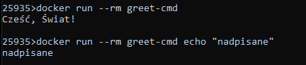

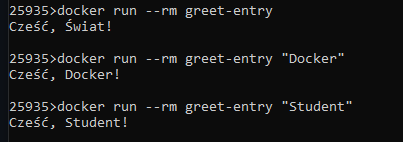

*Rysunek 4. Porównanie działania instrukcji CMD i ENTRYPOINT.*

---

### Ćwiczenie 2.4 - USER - użytkownik nie-root

**Opis:**

Utworzono obraz uruchamiający aplikację jako zwykły użytkownik `appuser`. Porównano jego identyfikator z identyfikatorem użytkownika root.

**Użyte polecenia:**

```bash
docker build -t user-test .
docker run --rm user-test
docker run --rm python:3.11-slim python -c "import os; print(f'UID: {os.getuid()}')"
```

**Wynik działania:**

Kontener z `USER appuser` działał z identyfikatorem innym niż 0, natomiast użytkownik root miał `UID: 0`.

---

### Ćwiczenie 3.1 - Wpływ .dockerignore

**Opis:**

Utworzono folder zawierający duży plik testowy, a następnie zbudowano obraz przed dodaniem `.dockerignore` i po jego dodaniu. Porównano rozmiar kontekstu przesyłanego podczas budowania.

**Użyte polecenia:**

```bash
docker build -t ignore-test:without .
docker build -t ignore-test:with .
```

**Wynik działania:**

Bez `.dockerignore` przesyłany kontekst miał **52,44 MB**, a po dodaniu pliku `.dockerignore` tylko **154 B**.

**Screenshot:**

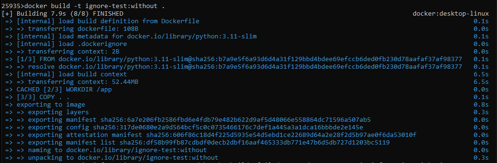

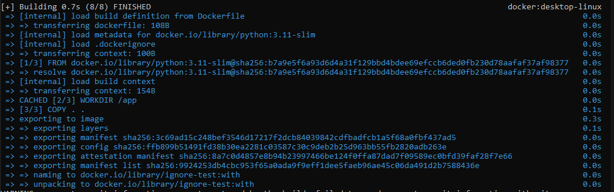

*Rysunek 5. Porównanie rozmiaru kontekstu budowania bez .dockerignore i z .dockerignore.*

---

### Ćwiczenie 4.1 - Multi-stage dla aplikacji Go

**Opis:**

Przygotowano dwa pliki Dockerfile dla tej samej aplikacji Go: standardowy oraz wieloetapowy. Następnie porównano rozmiary gotowych obrazów.

**Użyte polecenia:**

```bash
docker build -t go-app:single -f Dockerfile.single .
docker build -t go-app:multi -f Dockerfile.multi .
docker images go-app
```

**Wynik działania:**

Rozmiar standardowego obrazu wynosił **319 MB**, natomiast obrazu multi-stage **4,04 MB**. Obraz wieloetapowy okazał się znacznie mniejszy.

**Screenshot:**

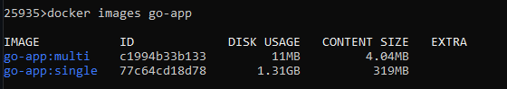

*Rysunek 6. Porównanie rozmiarów obrazów single-stage i multi-stage dla Go.*

---

### Ćwiczenie 4.2 - Multi-stage dla Node.js

**Opis:**

Utworzono aplikację w Node.js i przygotowano dla niej wieloetapowy Dockerfile. Zależności zainstalowano w pierwszym etapie, a do końcowego obrazu skopiowano pliki potrzebne do uruchomienia aplikacji.

**Użyte polecenia:**

```bash
docker run --rm -v "%cd%:/app" -w /app node:20-alpine npm install --package-lock-only
docker build -t node-app:v1 .
docker run -d --name node-test -p 3000:3000 node-app:v1
curl http://localhost:3000
```

**Wynik działania:**

Kontener został uruchomiony, a aplikacja odpowiadała pod adresem `http://localhost:3000`.

---

### Ćwiczenie 5.1 - Optymalizacja cache

**Opis:**

Przygotowano dwa warianty Dockerfile różniące się kolejnością kopiowania plików i instalowania zależności. Po zmianie tekstu w `app.py` ponownie zbudowano oba obrazy.

**Użyte polecenia:**

```bash
docker build -t cache-bad -f Dockerfile.bad .
docker build -t cache-good -f Dockerfile.good .
docker build -t cache-bad:v2 -f Dockerfile.bad .
docker build -t cache-good:v2 -f Dockerfile.good .
```

**Wynik działania:**

W wariancie `bad` Docker ponownie wykonał instalację zależności. W wariancie `good` warstwa instalacji została wykorzystana z pamięci podręcznej (`CACHED`).

**Screenshot:**

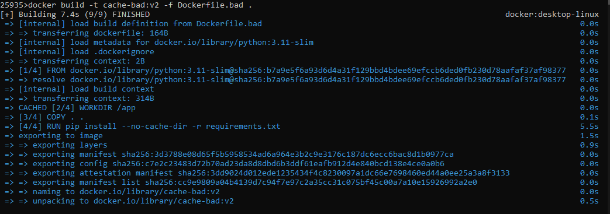

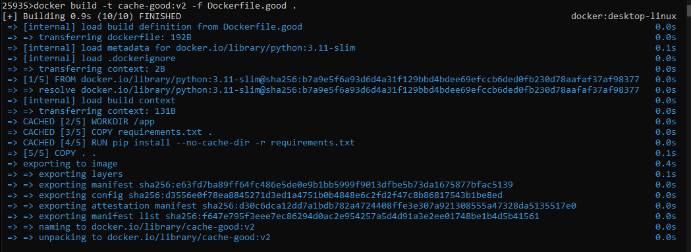

*Rysunek 7. Porównanie wykorzystania cache przy różnej kolejności instrukcji Dockerfile.*

---

### Ćwiczenie 6.1 - HEALTHCHECK

**Opis:**

Dodano do Dockerfile instrukcję `HEALTHCHECK`, która sprawdza endpoint `/health`. Po uruchomieniu kontenera sprawdzono jego stan.

**Użyte polecenia:**

```bash
docker build -t health-test .
docker run -d --name health-app -p 5000:5000 health-test
docker ps
docker inspect --format="{{.State.Health.Status}}" health-app
```

**Wynik działania:**

Kontener `health-app` uzyskał status `healthy`, co potwierdziło poprawne działanie sprawdzania stanu aplikacji.

**Screenshot:**

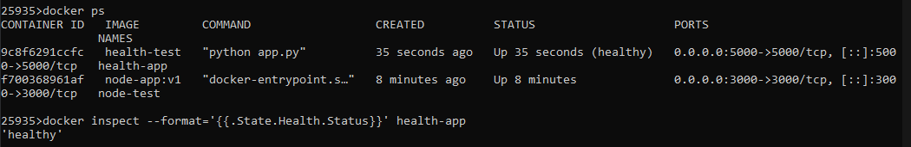

*Rysunek 8. Sprawdzenie stanu kontenera za pomocą HEALTHCHECK i docker inspect.*

---

### Ćwiczenie 7.1 - Publikacja obrazu na Docker Hub

**Opis:**

Zalogowano się do Docker Hub, nadano obrazowi Flask tagi `v1` i `latest`, a następnie opublikowano go w repozytorium. Usunięto lokalne tagi i ponownie pobrano obraz, aby sprawdzić działanie publikacji.

**Użyte polecenia:**

```bash
docker login
docker build -t flask-app:v1 "%USERPROFILE%\Desktop\docker-lab02\hello-python"
docker tag flask-app:v1 patrycjat/flask-app:v1
docker tag flask-app:v1 patrycjat/flask-app:latest
docker push patrycjat/flask-app:v1
docker push patrycjat/flask-app:latest
docker rmi patrycjat/flask-app:v1 patrycjat/flask-app:latest
docker pull patrycjat/flask-app:v1
docker run --rm patrycjat/flask-app:v1
```

**Wynik działania:**

Oba tagi zostały opublikowane w repozytorium `patrycjat/flask-app`. Po ponownym pobraniu obraz uruchomił aplikację Flask.

**Screenshot:**

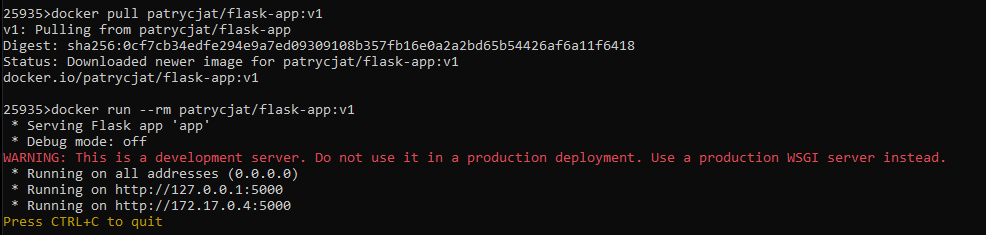

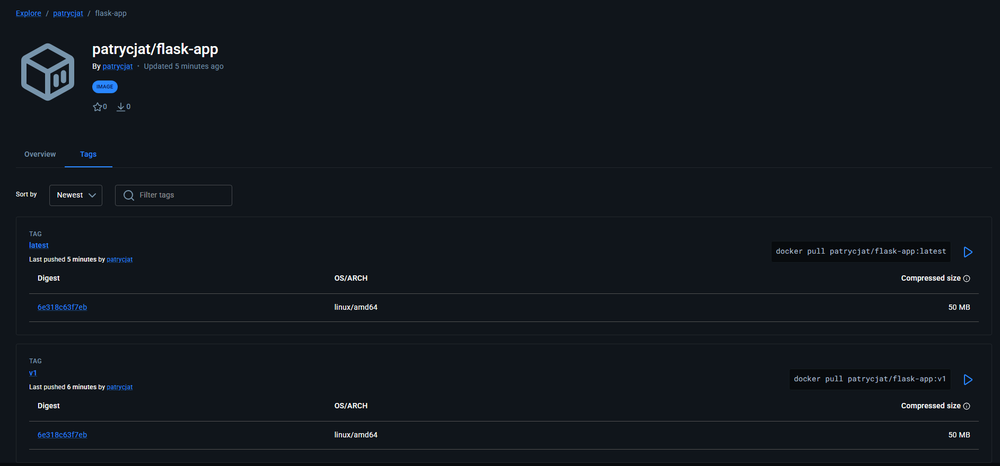

*Rysunek 9. Pobranie i uruchomienie obrazu Flask oraz widok opublikowanych tagów na Docker Hub.*

---

## 4. Zadania samodzielne

### Zadanie 1 - Dockerfile dla Django

**Opis:**

Wykorzystano przykładową aplikację Django z materiałów. Przygotowano własny plik `Dockerfile.zad1`, zbudowano obraz i uruchomiono aplikację na porcie 8000.

**Użyte polecenia:**

```bash
docker build -t django-zad1 -f Dockerfile.zad1 .
docker run -d --name django-zad1-test -p 8000:8000 django-zad1
docker ps
```

**Wynik działania:**

Kontener uruchomił się prawidłowo. Pod adresem `http://localhost:8000` wyświetlono formularz aplikacji Open-Meteo. 

**Screenshot:**

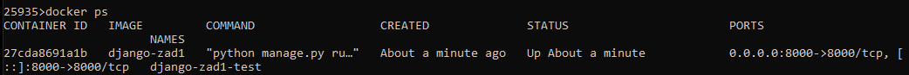

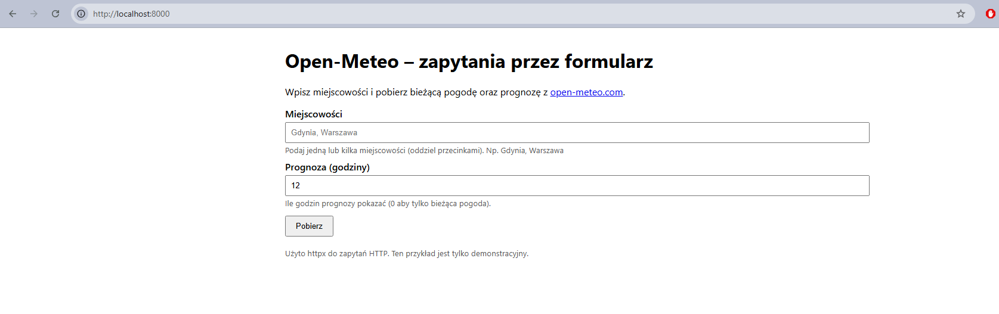

*Rysunek 10. Uruchomienie aplikacji Django w kontenerze i sprawdzenie formularza w przeglądarce.*

---

### Zadanie 2 - Multi-stage dla Pythona

**Opis:**

Przygotowano dwustopniowy Dockerfile dla prostej aplikacji Flask. W pierwszym etapie instalowano biblioteki, a do drugiego kopiowano potrzebne zależności i plik aplikacji.

**Użyte polecenia:**

```bash
docker build -t python-multistage:v1 .
docker run -d --name python-multistage-test -p 5002:5000 python-multistage:v1
docker ps
```

**Wynik działania:**

Obraz multi-stage został poprawnie zbudowany. Pod adresem `http://localhost:5002` wyświetliła się strona z komunikatem „Aplikacja Python - Multi-stage Docker!”.

**Screenshot:**

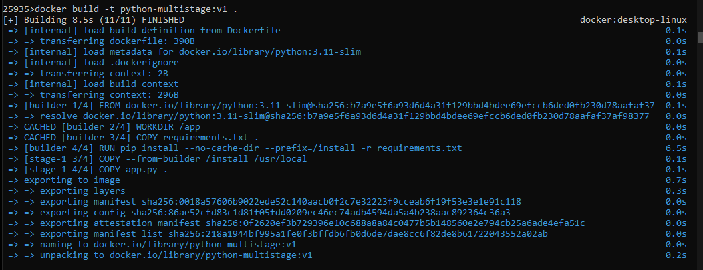

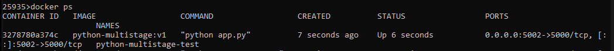

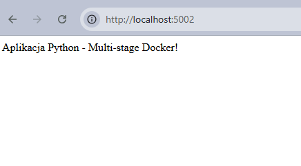

*Rysunek 11. Budowanie i uruchomienie aplikacji Python z użyciem multi-stage build.*

---

### Zadanie 3 - Optymalizacja rozmiaru obrazu

**Opis:**

Porównano zwykły obraz aplikacji Flask z obrazem zoptymalizowanym. W drugiej wersji zastosowano obraz bazowy `python:3.11-slim`, plik `.dockerignore` oraz multi-stage build.

**Użyte polecenia:**

```bash
docker build -t flask-before:v1 -f Dockerfile.before .
docker images flask-before
docker build -t flask-after:v1 -f Dockerfile.after .
docker images flask-after
docker run --rm -d --name flask-after-test -p 5003:5000 flask-after:v1
```

**Wynik działania:**

Rozmiar obrazu zmniejszył się z **417 MB** do **47,2 MB**. Zoptymalizowana aplikacja uruchomiła się poprawnie pod adresem `http://localhost:5003`.


**Screenshot:**

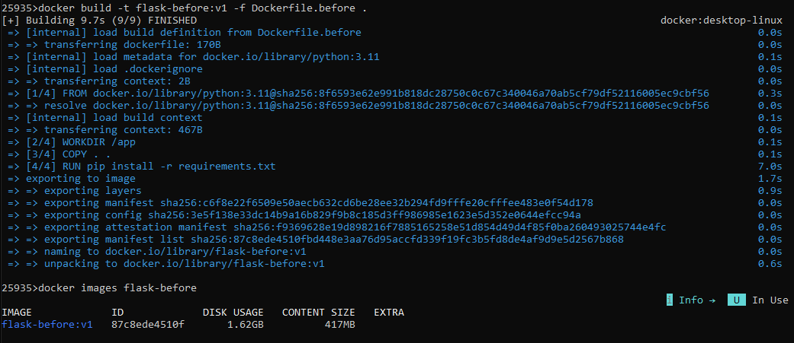

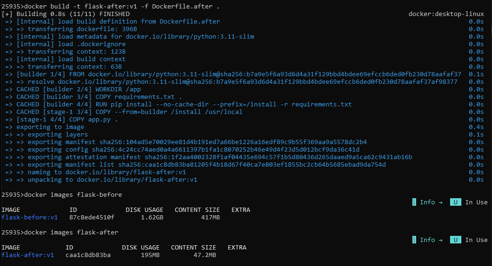

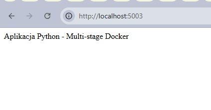

*Rysunek 12. Optymalizacja obrazu Docker, porównanie rozmiarów przed i po optymalizacji oraz sprawdzenie działania aplikacji.*


---

## 5. Wnioski

Podczas laboratorium nauczyłam się tworzyć własne obrazy Dockera za pomocą Dockerfile. Sprawdziłam, jak działają różne instrukcje oraz w jaki sposób można zmniejszyć rozmiar obrazu i przyspieszyć jego budowanie. Udało mi się również opublikować obraz na Docker Hub i uruchomić go po ponownym pobraniu. Ćwiczenia pomogły mi lepiej zrozumieć budowanie i uruchamianie aplikacji w kontenerach.
