# Sprawozdanie z laboratorium nr 3

**Przedmiot:** Aplikacje w środowisku kontenerowym  
**Temat:** Wolumeny i trwałość danych  
**Data wykonania:** 19.11.2026  
**Autor:** Patrycja Teska  
**Numer indeksu:** 25935  
**Grupa:** 235IC, A2

## 1. Cel laboratorium

Celem laboratorium było poznanie sposobów przechowywania danych w Dockerze. W trakcie ćwiczeń sprawdzono działanie wolumenów, bind mounts oraz tmpfs. Przećwiczono również uruchamianie baz danych z wolumenami, współdzielenie danych między kontenerami oraz wykonywanie i przywracanie kopii zapasowych.

## 2. Wstęp teoretyczny

Docker umożliwia przechowywanie danych poza systemem plików kontenera. Wolumeny (volumes) pozwalają zachować dane nawet po usunięciu kontenera. Bind mounts umożliwiają udostępnianie kontenerowi plików i katalogów znajdujących się na komputerze. Z kolei tmpfs przechowuje dane tymczasowo w pamięci operacyjnej.

Ważnym elementem pracy z danymi jest również wykonywanie kopii zapasowych. Backup pozwala zabezpieczyć dane, a restore umożliwia ich przywrócenie.

## 3. Przebieg ćwiczeń

### Ćwiczenie 1.1 - Tworzenie i zarządzanie wolumenami

**Opis:**

Utworzono wolumen `moje-dane`, wyświetlono listę dostępnych wolumenów oraz sprawdzono jego szczegółowe informacje.

**Użyte polecenia:**

```cmd
docker volume create moje-dane
docker volume ls
docker volume inspect moje-dane
```

**Wynik działania:**

Wolumen `moje-dane` został poprawnie utworzony. Polecenie `docker volume inspect` wyświetliło informacje o jego nazwie, sterowniku i lokalizacji przechowywania danych.

**Screenshot:**

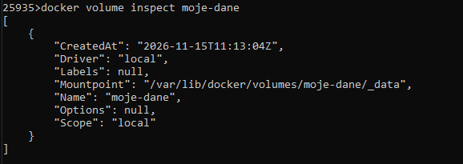

*Rysunek 1. Szczegółowe informacje o utworzonym wolumenie Docker.*

### Ćwiczenie 1.2 - Użycie wolumenu z kontenerem

**Opis:**

Zapisano tekst i datę do pliku znajdującego się w wolumenie. Następnie uruchomiono drugi kontener, który odczytał zapisane dane.

**Użyte polecenia:**

```cmd
docker run --rm -v moje-dane:/data ubuntu bash -c "echo Dane trwale! > /data/plik.txt && date >> /data/plik.txt"
docker run --rm -v moje-dane:/data ubuntu cat /data/plik.txt
```

**Wynik działania:**

Drugi kontener poprawnie odczytał tekst i datę. Potwierdziło to, że dane w wolumenie pozostały zapisane pomimo usunięcia pierwszego kontenera.

### Ćwiczenie 1.3 - Efemeryczność danych bez wolumenu

**Opis:**

Utworzono plik wewnątrz kontenera bez podłączania wolumenu. Następnie kontener zatrzymano i usunięto, aby sprawdzić dostępność danych.

**Użyte polecenia:**

```cmd
docker run -d --name temp ubuntu bash -c "echo Dane tymczasowe > /tmp/dane.txt && sleep infinity"
docker exec temp cat /tmp/dane.txt
docker stop temp
docker rm temp
docker ps -a
docker run --rm -v moje-dane:/data ubuntu cat /data/plik.txt
```

**Wynik działania:**

Po usunięciu kontenera `temp` zapisany w nim plik nie był już dostępny. Dane znajdujące się w wolumenie `moje-dane` nadal można było odczytać.

**Screenshot:**

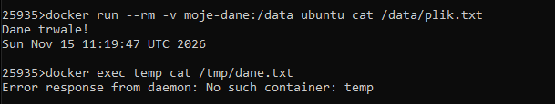

*Rysunek 2. Porównanie trwałości danych zapisanych z wolumenem i bez wolumenu.*


### Ćwiczenie 2.1 - Montowanie katalogu z hosta

**Opis:**

Utworzono folder `web-content` z plikiem `index.html`. Następnie podłączono go do kontenera Nginx za pomocą bind mount i sprawdzono wyświetlanie strony w przeglądarce.

**Użyte polecenia:**

```cmd
mkdir web-content
docker run -d --name web -p 8080:80 -v "%cd%\web-content:/usr/share/nginx/html:ro" nginx:alpine
curl http://localhost:8080
```

**Wynik działania:**

Nginx poprawnie wyświetlił stronę z napisem „Strona z hosta!” pod adresem `http://localhost:8080`.

**Screenshot:**

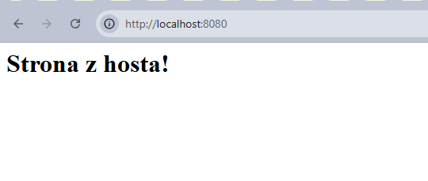

*Rysunek 3. Strona HTML udostępniona przez Nginx z wykorzystaniem bind mount.*


### Ćwiczenie 2.3 - Bind mount dla development

**Opis:**

Przygotowano aplikację Flask, plik `requirements.txt` oraz Dockerfile. Po uruchomieniu aplikacji zmieniono tekst w pliku `app.py` i sprawdzono automatyczne przeładowanie.

**Użyte polecenia:**

```cmd
docker build -t dev-app .
docker run -d --name dev -p 5000:5000 -v "%cd%\app.py:/app/app.py" dev-app
curl http://localhost:5000
docker stop dev
docker rm dev
```

**Wynik działania:**

Aplikacja początkowo wyświetlała „Laboratorium 3 - Wersja 1”. Po zmianie kodu pojawił się napis „Laboratorium 3 - Wersja 2” bez ponownego budowania obrazu i restartowania kontenera.

**Screenshot:**

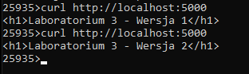

*Rysunek 4. Aktualizacja aplikacji Flask bez ponownego uruchamiania kontenera.*

### Ćwiczenie 3.1 - PostgreSQL z trwałymi danymi

**Opis:**

Utworzono wolumen `pgdata` i uruchomiono kontener PostgreSQL. W bazie `studenci` utworzono tabelę oraz dodano dwa rekordy. Następnie usunięto kontener i uruchomiono nowy z tym samym wolumenem.

**Użyte polecenia:**

```cmd
docker volume create pgdata

docker run -d --name postgres -e POSTGRES_PASSWORD=secret -e POSTGRES_DB=studenci -v pgdata:/var/lib/postgresql/data -p 5433:5432 postgres:16-alpine

docker exec -it postgres psql -U postgres -d studenci -c "CREATE TABLE studenci (id SERIAL PRIMARY KEY, imie VARCHAR(50), nazwisko VARCHAR(50), nr_indeksu VARCHAR(10));"

docker exec -it postgres psql -U postgres -d studenci -c "INSERT INTO studenci (imie, nazwisko, nr_indeksu) VALUES ('Jan', 'Kowalski', '123456'), ('Anna', 'Nowak', '654321');"

docker exec -it postgres psql -U postgres -d studenci -c "SELECT * FROM studenci;"
```

**Wynik działania:**

W tabeli zapisano dane Jana Kowalskiego i Anny Nowak.

**Screenshot:**

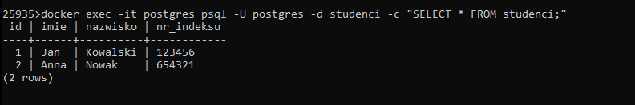

*Rysunek 5. Tabela studenci z dwoma rekordami w PostgreSQL.*

**Sprawdzenie trwałości danych:**

```cmd
docker stop postgres
docker rm postgres

docker run -d --name postgres-new -e POSTGRES_PASSWORD=secret -v pgdata:/var/lib/postgresql/data -p 5433:5432 postgres:16-alpine

docker exec -it postgres-new psql -U postgres -d studenci -c "SELECT * FROM studenci;"
```

**Wynik działania:**

Po uruchomieniu nowego kontenera dane obu studentów nadal znajdowały się w bazie.

**Screenshot:**

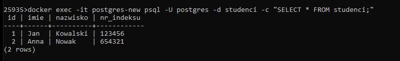

*Rysunek 6. Dane PostgreSQL zachowane po usunięciu i ponownym utworzeniu kontenera.*


### Ćwiczenie 4.1 - Współdzielenie wolumenów

**Opis:**

Utworzono wolumen `shared-logs`, z którego korzystały dwa kontenery. Kontener Writer zapisywał logi, natomiast Reader odczytywał je w trybie tylko do odczytu.

**Użyte polecenia:**

```cmd
docker volume create shared-logs

docker run -d --name writer -v shared-logs:/logs ubuntu bash -c "while true; do date >> /logs/app.log; sleep 3; done"

docker run --rm -v shared-logs:/logs:ro ubuntu tail -5 /logs/app.log

docker run --rm -v shared-logs:/logs:ro ubuntu tail -f /logs/app.log

docker stop writer
docker rm writer
```

**Wynik działania:**

Kontener Reader poprawnie odczytywał logi zapisywane przez Writer. Nowe wpisy pojawiały się co około 3 sekundy.

**Screenshot:**

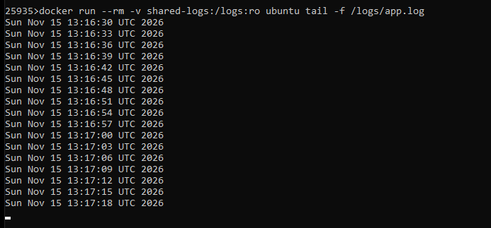

*Rysunek 7. Odczytywanie logów ze współdzielonego wolumenu Docker.*


### Ćwiczenie 5.2 - Restore wolumenu

**Opis:**

Utworzono nowy wolumen `pgdata-restored`, do którego rozpakowano wcześniej wykonany backup. Następnie uruchomiono kontener PostgreSQL i sprawdzono zachowane dane.

**Użyte polecenia:**

```cmd
docker volume create pgdata-restored

docker run --rm -v pgdata-restored:/target -v "%cd%:/backup:ro" ubuntu tar xzf /backup/pgdata-backup.tar.gz -C /target

docker run -d --name postgres-restored -e POSTGRES_PASSWORD=secret -v pgdata-restored:/var/lib/postgresql/data -p 5433:5432 postgres:16-alpine

docker exec -it postgres-restored psql -U postgres -d studenci -c "SELECT * FROM studenci;"
```

**Wynik działania:**

Baza PostgreSQL została poprawnie przywrócona. W tabeli nadal znajdowały się dane Jana Kowalskiego i Anny Nowak.

**Screenshot:**

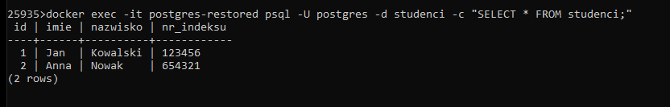

*Rysunek 8. Dane PostgreSQL przywrócone z kopii zapasowej wolumenu.*


### Ćwiczenie 7.1 - Sprzątanie wolumenów

**Opis:**

Sprawdzono listę kontenerów i wolumenów. Następnie usunięto zasoby utworzone na potrzeby laboratorium 3, pozostawiając dane innych projektów.

**Użyte polecenia:**

```cmd
docker volume ls
docker ps -a

docker rm -f postgres-restored postgres-new mysql mongo

docker rm -f cool_hermann

docker volume rm moje-dane mongodata mysqldata pgdata pgdata-restored shared-logs

docker volume ls
docker system df
```

**Wynik działania:**

Usunięto kontenery i wolumeny z ćwiczeń.

**Screenshot:**

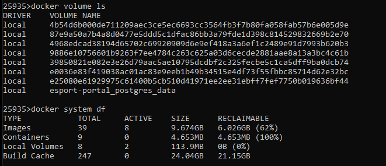

*Rysunek 9. Lista wolumenów po sprzątaniu oraz wykorzystanie miejsca przez Docker.*

## 4. Zadania samodzielne

### Zadanie 1 - Redis z trwałymi danymi

**Opis:**

Uruchomiono Redis z wolumenem `redis-data`. Zapisano trzy klucze, a następnie zatrzymano i usunięto kontener. Po uruchomieniu nowego kontenera z tym samym wolumenem sprawdzono zachowane dane.

**Użyte polecenia:**

```cmd
docker volume create redis-data

docker run -d --name redis-lab3 -v redis-data:/data redis:7 redis-server --appendonly yes

docker exec redis-lab3 redis-cli SET imie Patrycja
docker exec redis-lab3 redis-cli SET uczelnia AMW
docker exec redis-lab3 redis-cli SET przedmiot Docker

docker exec redis-lab3 redis-cli GET imie
docker exec redis-lab3 redis-cli GET uczelnia
docker exec redis-lab3 redis-cli GET przedmiot
```

**Screenshot:**

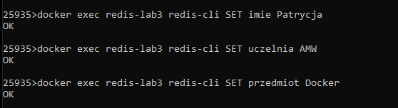

*Rysunek 10. Zapisanie trzech kluczy w bazie Redis.*

**Sprawdzenie trwałości danych:**

```cmd
docker stop redis-lab3
docker rm redis-lab3

docker run -d --name redis-lab3-new -v redis-data:/data redis:7 redis-server --appendonly yes

docker exec redis-lab3-new redis-cli GET imie
docker exec redis-lab3-new redis-cli GET uczelnia
docker exec redis-lab3-new redis-cli GET przedmiot
```

**Wynik działania:**

Po usunięciu kontenera dane pozostały zapisane w wolumenie. Nowy kontener poprawnie odczytał wartości `Patrycja`, `AMW` i `Docker`.

**Screenshot:**

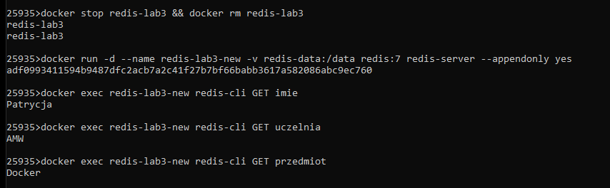

*Rysunek 11. Odczyt danych Redis po usunięciu i ponownym utworzeniu kontenera.*

### Zadanie 2 - Serwer plików Nginx

**Opis:**

Przygotowano folder `zad2-nginx/web-content` zawierający stronę HTML. Uruchomiono kontener Nginx z bind mount, a następnie dodano kolejny plik `kontakt.html` bez restartowania kontenera.

**Użyte polecenia:**

```cmd
docker run -d --name nginx-zad2 -p 8081:80 -v "%cd%\web-content:/usr/share/nginx/html:ro" nginx:alpine

curl http://localhost:8081
```

**Wynik działania:**

Strona główna została poprawnie wyświetlona pod adresem `http://localhost:8081`.

**Screenshot:**

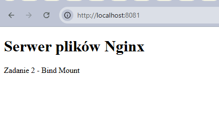

*Rysunek 12. Strona HTML udostępniona przez serwer Nginx.*

Następnie dodano plik `kontakt.html` do folderu `web-content` i otworzono go w przeglądarce.

**Wynik działania:**

Nowa strona była dostępna pod adresem `http://localhost:8081/kontakt.html` bez ponownego uruchamiania kontenera.

**Screenshot:**

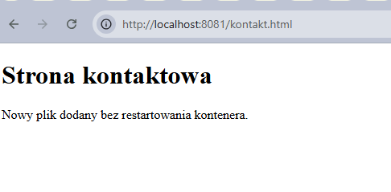

*Rysunek 13. Udostępnienie nowego pliku HTML bez restartowania kontenera.*

### Zadanie 3 - Automatyczny backup wolumenu

**Opis:**

Przygotowano skrypt Bash `backup.sh`, który tworzy kopię zapasową wolumenu i automatycznie dodaje datę oraz godzinę do nazwy pliku. Najpierw przetestowano jego działanie na wolumenie z plikiem tekstowym, a następnie wykonano backup wolumenu testowej bazy PostgreSQL.

**Użyte polecenia:**

```cmd
docker volume create backup-test

docker run --rm -v backup-test:/data ubuntu bash -c "echo Przykladowe dane do backupu > /data/dane.txt"

docker run --rm -v backup-test:/data ubuntu cat /data/dane.txt
```

**Zawartość pliku `backup.sh`:**

```bash
#!/bin/bash

VOLUME_NAME="pgdata-zad3"
BACKUP_DIR="$(cd "$(dirname "$0")" && pwd -W)/backups"
TIMESTAMP=$(date +%Y%m%d-%H%M%S)

mkdir -p "$BACKUP_DIR"

docker run --rm \
  -v "$VOLUME_NAME:/source:ro" \
  -v "$BACKUP_DIR:/backup" \
  ubuntu tar czf "/backup/backup-$TIMESTAMP.tar.gz" -C /source .

echo "Backup utworzony: backup-$TIMESTAMP.tar.gz"
```

**Uruchomienie skryptu w Git Bash:**

```bash
MSYS_NO_PATHCONV=1 bash backup.sh
```

**Sprawdzenie pierwszego backupu:**

```bash
tar -tzf backups/backup-20261115-150517.tar.gz
tar -xOzf backups/backup-20261115-150517.tar.gz ./dane.txt
```

**Wynik działania:**

Skrypt utworzył archiwum z datą i godziną w nazwie. Sprawdzono, że zawiera ono plik `dane.txt` z zapisanym tekstem.

**Screenshot:**

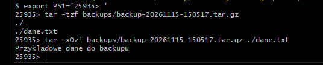

*Rysunek 14. Sprawdzenie zawartości automatycznie utworzonej kopii zapasowej.*

**Backup wolumenu PostgreSQL:**

Utworzono wolumen `pgdata-zad3` i kontener PostgreSQL z bazą `testbackup`. Dodano tabelę `produkty` zawierającą dwa rekordy. Po zatrzymaniu kontenera zmieniono nazwę wolumenu w skrypcie i wykonano backup.

**Użyte polecenia:**

```cmd
docker volume create pgdata-zad3

docker run -d --name postgres-zad3 -e POSTGRES_PASSWORD=secret -e POSTGRES_DB=testbackup -v pgdata-zad3:/var/lib/postgresql/data postgres:16-alpine

docker exec -it postgres-zad3 psql -U postgres -d testbackup -c "CREATE TABLE produkty (id SERIAL PRIMARY KEY, nazwa VARCHAR(50)); INSERT INTO produkty (nazwa) VALUES ('Laptop'), ('Mysz');"

docker exec -it postgres-zad3 psql -U postgres -d testbackup -c "SELECT * FROM produkty;"

docker stop postgres-zad3
```

W skrypcie ustawiono:

```bash
VOLUME_NAME="pgdata-zad3"
```

Następnie w Git Bash wykonano:

```bash
MSYS_NO_PATHCONV=1 bash backup.sh

ls -lh backups/

tar -tzf backups/backup-20261115-151016.tar.gz | head -20
```

**Wynik działania:**

Powstał plik `backup-20261115-151016.tar.gz` o rozmiarze około 6,5 MB. Sprawdzenie archiwum pokazało katalogi i pliki PostgreSQL, między innymi `global` i `pg_subtrans`.

**Screenshot:**

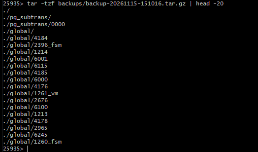

*Rysunek 15. Sprawdzenie zawartości automatycznej kopii wolumenu PostgreSQL.*

## 5. Wnioski

Podczas laboratorium nauczyłam się korzystać z różnych sposobów przechowywania danych w Dockerze. Sprawdziłam, że wolumeny pozwalają zachować dane nawet po usunięciu kontenera, a bind mounts umożliwiają korzystanie z plików znajdujących się na komputerze. Przećwiczyłam również tworzenie i przywracanie kopii zapasowych. Dzięki wykonanym zadaniom lepiej zrozumiałam, jak zabezpieczać i udostępniać dane między kontenerami.
