# Sprawozdanie z laboratorium nr 4

**Przedmiot:** Aplikacje w środowisku kontenerowym  
**Temat:** Sieci Docker  
**Data wykonania:** 19.11.2026  
**Autor:** Patrycja Teska  
**Numer indeksu:** 25935  
**Grupa:** 235IC, A2

## 1. Cel laboratorium

Celem laboratorium było poznanie działania sieci w Dockerze oraz sposobów komunikacji między kontenerami. W trakcie ćwiczeń sprawdzono domyślną sieć bridge, tworzenie własnych sieci, działanie DNS, izolację kontenerów oraz mapowanie portów.

## 2. Wstęp teoretyczny

Docker umożliwia łączenie kontenerów za pomocą różnych typów sieci. Domyślna sieć bridge pozwala na komunikację między kontenerami przy użyciu adresów IP, natomiast własne sieci bridge zapewniają również rozpoznawanie nazw kontenerów przez DNS.

Mapowanie portów umożliwia dostęp do usług uruchomionych w kontenerach z poziomu komputera. Sieć host pozwala kontenerowi korzystać z sieci hosta, a sieć none odłącza go od zewnętrznej komunikacji sieciowej.

Dzięki odpowiedniej konfiguracji sieci można oddzielić frontend, backend i bazę danych, ograniczając bezpośredni dostęp między usługami.

## 3. Przebieg ćwiczeń

### Ćwiczenie 1.1 - Eksploracja domyślnej sieci bridge

**Opis:**

Wyświetlono dostępne sieci Docker oraz szczegóły domyślnej sieci bridge. Następnie uruchomiono dwa kontenery Alpine i sprawdzono komunikację między nimi po adresie IP oraz nazwie.

**Użyte polecenia:**

```bash
docker network ls
docker network inspect bridge

docker run -d --name kontener-a alpine sleep 3600
docker run -d --name kontener-b alpine sleep 3600

docker inspect -f '{{range .NetworkSettings.Networks}}{{.IPAddress}}{{end}}' kontener-a
docker inspect -f '{{range .NetworkSettings.Networks}}{{.IPAddress}}{{end}}' kontener-b

docker exec kontener-a ping -c 3 $(docker inspect -f '{{range .NetworkSettings.Networks}}{{.IPAddress}}{{end}}' kontener-b)

docker exec kontener-a ping -c 3 kontener-b
```

**Wynik działania:**

Ping po adresie IP `172.17.0.4` zakończył się sukcesem, a utrata pakietów wyniosła 0%. Próba komunikacji po nazwie `kontener-b` zwróciła błąd `bad address`, ponieważ domyślna sieć bridge nie zapewnia automatycznego rozpoznawania nazw kontenerów.

**Screenshot:**

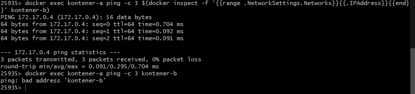

*Rysunek 1. Porównanie komunikacji po adresie IP i nazwie kontenera w domyślnej sieci bridge.*


### Ćwiczenie 2.1 - Tworzenie własnej sieci i DNS

**Opis:**

Utworzono sieć `moja-siec`, do której podłączono kontenery Nginx i Alpine. Następnie sprawdzono komunikację po nazwie kontenera oraz działanie DNS.

**Użyte polecenia:**

```bash
docker network create moja-siec

docker run -d --name web --network moja-siec nginx:alpine
docker run -d --name app --network moja-siec alpine sleep 3600

docker exec app ping -c 3 web
docker exec app nslookup web
```

**Wynik działania:**

Ping do kontenera `web` zakończył się sukcesem, a utrata pakietów wyniosła 0%. Polecenie `nslookup` zwróciło adres `172.19.0.2`, potwierdzając poprawne działanie DNS w sieci użytkownika.

**Screenshot:**

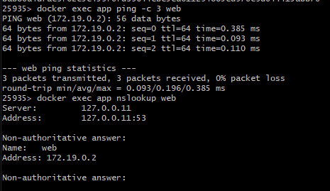

*Rysunek 2. Poprawna komunikacja po nazwie kontenera i rozpoznawanie DNS w sieci użytkownika.*

### Ćwiczenie 2.2 - Izolacja sieci

**Opis:**

Utworzono drugą sieć `inna-siec` i uruchomiono w niej kontener `isolated`. Następnie sprawdzono, czy może on komunikować się z kontenerem `web` znajdującym się w sieci `moja-siec`.

**Użyte polecenia:**

```bash
docker network create inna-siec

docker run -d --name isolated --network inna-siec alpine sleep 3600

docker exec isolated ping -c 2 web
```

**Wynik działania:**

Próba komunikacji zwróciła komunikat `ping: bad address 'web'`. Kontener `isolated` nie mógł odnaleźć kontenera z innej sieci, co potwierdziło działanie izolacji sieciowej.

**Screenshot:**

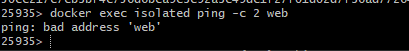

*Rysunek 3. Brak możliwości komunikacji po nazwie między kontenerami w oddzielnych sieciach Docker.*

### Ćwiczenie 2.3 - Podłączanie kontenera do wielu sieci

**Opis:**

Podłączono kontener `app` do drugiej sieci, dzięki czemu należał jednocześnie do `moja-siec` i `inna-siec`. Sprawdzono jego komunikację z kontenerami w obu sieciach.

**Użyte polecenia:**

```bash
docker network connect inna-siec app

docker exec app ping -c 2 web
docker exec app ping -c 2 isolated

docker network disconnect inna-siec app
```

**Wynik działania:**

Kontener `app` poprawnie komunikował się zarówno z `web`, jak i `isolated`. Po zakończeniu testów odłączono go od sieci `inna-siec`.

### Ćwiczenie 2.4 - Sieć z niestandardową konfiguracją

**Opis:**

Utworzono własną sieć bridge z określoną podsiecią i bramą domyślną. Następnie uruchomiono kontener ze statycznie przypisanym adresem IP.

**Użyte polecenia:**

```bash
docker network create \
  --driver bridge \
  --subnet 172.30.0.0/16 \
  --gateway 172.30.0.1 \
  custom-net

docker run -d --name custom-c1 --network custom-net --ip 172.30.0.10 alpine sleep 3600

docker inspect -f '{{range .NetworkSettings.Networks}}{{.IPAddress}}{{end}}' custom-c1
```

**Wynik działania:**

Kontener `custom-c1` otrzymał wskazany adres IP `172.30.0.10`. Potwierdziło to możliwość samodzielnego określania adresacji sieci Docker.

Po wykonaniu ćwiczeń usunięto kontenery i sieci utworzone w części 2.

**Użyte polecenia:**

```bash
docker stop web app isolated custom-c1
docker rm web app isolated custom-c1

docker network rm moja-siec inna-siec custom-net
```

### Ćwiczenie 3.1 - Różne tryby mapowania portów

**Opis:**

Uruchomiono cztery kontenery Nginx z różnymi sposobami mapowania portów. Sprawdzono porty przydzielone automatycznie, dostęp ograniczony do localhost oraz mapowanie wielu portów.

**Użyte polecenia:**

```bash
docker run -d --name web1 -p 8080:80 nginx:alpine

docker run -d --name web2 -p 80 nginx:alpine
docker port web2

docker run -d --name web3 -p 127.0.0.1:8081:80 nginx:alpine

docker run -d --name web4 -p 8082:80 -p 8443:443 nginx:alpine

docker ps --format "table {{.Names}}\t{{.Ports}}"

curl http://localhost:8080
curl http://localhost:8081
```

**Wynik działania:**

Kontener `web1` korzystał z portu 8080, `web2` otrzymał automatycznie port 52613, `web3` był dostępny przez localhost na porcie 8081, a `web4` miał zmapowane porty 8082 i 8443.

Polecenia `curl` dla portów 8080 i 8081 zwróciły kod HTML domyślnej strony Nginx z napisem „Welcome to nginx!”.

**Screenshot:**

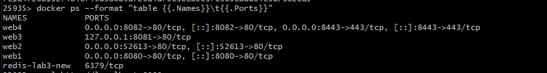

*Rysunek 4. Porównanie różnych sposobów mapowania portów w kontenerach Docker.*

Po zakończeniu testów usunięto cztery kontenery.

```bash
docker stop web1 web2 web3 web4
docker rm web1 web2 web3 web4
```

### Ćwiczenie 4.1 - Aplikacja webowa i baza danych

**Opis:**

Utworzono sieć `app-net`, w której uruchomiono bazę PostgreSQL oraz aplikację Adminer. Następnie połączono się z bazą za pomocą przeglądarki internetowej.

**Użyte polecenia:**

```bash
docker network create app-net

docker run -d --name db \
  --network app-net \
  -e POSTGRES_PASSWORD=secret \
  -e POSTGRES_DB=myapp \
  postgres:16-alpine

sleep 5

docker exec db pg_isready -U postgres -d myapp

docker run -d --name adminer \
  --network app-net \
  -p 8080:8080 \
  adminer
```

**Wynik działania:**

PostgreSQL został poprawnie uruchomiony, a Adminer był dostępny pod adresem `http://localhost:8080`. Po zalogowaniu z użyciem serwera `db`, użytkownika `postgres` i bazy `myapp` wyświetlono panel zarządzania bazą danych.

**Screenshot:**

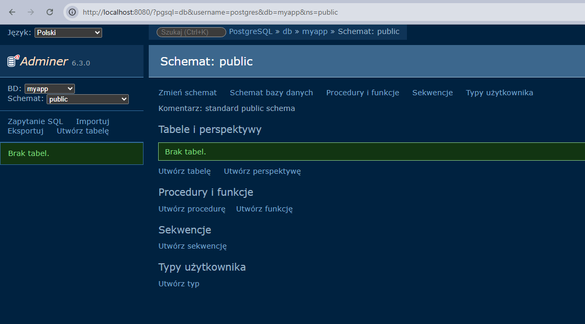

*Rysunek 5. Panel Adminer po poprawnym połączeniu z bazą PostgreSQL myapp.*

### Ćwiczenie 4.2 - Frontend, backend i baza danych

**Opis:**

Utworzono dwie sieci: `frontend-net` i `backend-net`. W sieci backendowej uruchomiono PostgreSQL i Redis. Kontener `app` podłączono do obu sieci, natomiast Nginx wyłącznie do sieci frontendowej.

**Użyte polecenia:**

```bash
docker network create frontend-net
docker network create backend-net

docker run -d --name db2 \
  --network backend-net \
  -e POSTGRES_PASSWORD=secret \
  postgres:16-alpine

docker run -d --name cache \
  --network backend-net \
  redis:7-alpine

docker run -d --name app \
  --network backend-net \
  alpine sleep 3600

docker network connect frontend-net app

docker run -d --name nginx \
  --network frontend-net \
  -p 80:80 \
  nginx:alpine

docker exec app ping -c 2 db2
docker exec app ping -c 2 cache
docker exec app ping -c 2 nginx

docker exec nginx ping -c 2 db2
```

**Wynik działania:**

Kontener `app` poprawnie komunikował się z bazą PostgreSQL, Redisem i Nginx. Natomiast próba komunikacji z kontenera Nginx do `db2` zwróciła błąd `bad address`.

Potwierdziło to, że Nginx nie ma bezpośredniego dostępu do nazwy bazy danych znajdującej się w sieci backendowej.

**Screenshot:**

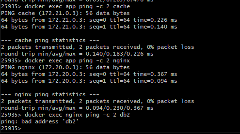

*Rysunek 6. Testy komunikacji między usługami oraz izolacja Nginx od bazy PostgreSQL.*

### Ćwiczenie 4.3 - Aliasy sieciowe

**Opis:**

Utworzono sieć `alias-net` i uruchomiono kontener PostgreSQL z dodatkowymi aliasami `database` oraz `db`. Następnie sprawdzono, czy wszystkie nazwy wskazują na ten sam kontener.

**Użyte polecenia:**

```bash
docker network create alias-net

docker run -d --name postgres-main \
  --network alias-net \
  --network-alias database \
  --network-alias db \
  -e POSTGRES_PASSWORD=secret \
  postgres:16-alpine

docker run --rm --network alias-net alpine ping -c 2 database
docker run --rm --network alias-net alpine ping -c 2 db
docker run --rm --network alias-net alpine ping -c 2 postgres-main
```

**Wynik działania:**

Wszystkie trzy testy zakończyły się poprawnie. Kontener PostgreSQL był dostępny zarówno pod właściwą nazwą `postgres-main`, jak i pod aliasami `database` oraz `db`.


### Ćwiczenie 5.2 - Sieć none

**Opis:**

Uruchomiono kontener Alpine bez dostępu do sieci i sprawdzono jego interfejsy oraz możliwość komunikacji z zewnętrznym adresem IP.

**Użyte polecenia:**

```bash
docker run --rm --network none alpine ip addr

docker run --rm --network none alpine ping -c 1 8.8.8.8
```

**Wynik działania:**

Kontener posiadał jedynie interfejs lokalny `lo` z adresem `127.0.0.1`. Próba połączenia z adresem `8.8.8.8` zakończyła się błędem `Network unreachable`, co potwierdziło brak dostępu do sieci zewnętrznej.

**Screenshot:**

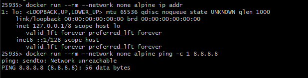

*Rysunek 7. Kontener uruchomiony bez dostępu do sieci oraz nieudana próba połączenia z internetem.*


### Ćwiczenie 7.1 - Sprzątanie sieci i kontenerów

**Opis:**

Zatrzymano i usunięto kontenery utworzone podczas laboratorium, a następnie usunięto niepotrzebne sieci.

**Użyte polecenia:**

```bash
docker stop db adminer db2 cache app nginx postgres-main diag

docker rm db adminer db2 cache app nginx postgres-main diag

docker network rm app-net frontend-net backend-net alias-net diag-net

docker network ls
docker system df
```

**Wynik działania:**

Po sprzątaniu pozostały standardowe sieci `bridge`, `host`, `none` oraz sieć `esport-portal_default`, wykorzystywana w innym projekcie.

Polecenie `docker system df` wyświetliło informacje o zajętym miejscu przez obrazy, kontenery, wolumeny i pamięć podręczną budowania.

**Screenshot:**

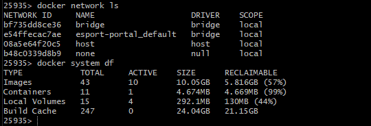

*Rysunek 8. Lista sieci po sprzątaniu oraz wykorzystanie miejsca przez Docker.*

## 4. Zadania samodzielne

### Zadanie 1 - Sieć wewnętrzna

**Opis:**

Utworzono sieć Docker z flagą `--internal` i uruchomiono w niej dwa kontenery Alpine. Następnie sprawdzono komunikację między kontenerami oraz próbę dostępu do internetu.

**Użyte polecenia:**

```bash
docker network create --internal internal-net

docker run -d --name internal-a --network internal-net alpine sleep 3600

docker run -d --name internal-b --network internal-net alpine sleep 3600

docker exec internal-a ping -c 3 internal-b

docker exec internal-a ping -c 3 8.8.8.8
```

**Wynik działania:**

Komunikacja między kontenerami zakończyła się sukcesem, a utrata pakietów wyniosła 0%. Próba połączenia z internetem zwróciła błąd `Network unreachable`.

Potwierdziło to, że sieć wewnętrzna umożliwia komunikację między kontenerami, ale ogranicza dostęp do sieci zewnętrznych.

**Screenshot:**

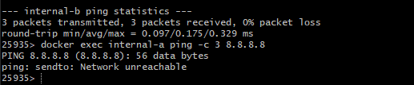

*Rysunek 9. Udana komunikacja między kontenerami oraz brak dostępu do internetu w sieci internal.*

Po zakończeniu testów usunięto utworzone zasoby.

```bash
docker stop internal-a internal-b
docker rm internal-a internal-b
docker network rm internal-net
```


### Zadanie 2 - Architektura trójwarstwowa

**Opis:**

Przygotowano architekturę składającą się z trzech usług: Nginx jako frontend, Python Flask jako backend oraz PostgreSQL jako baza danych.

Utworzono aplikację Flask z dwoma endpointami. Pierwszy wyświetlał komunikat o działaniu backendu, a drugi wykonywał zapytanie SQL `SELECT version()` do PostgreSQL.

Za pomocą Docker Compose skonfigurowano dwie sieci. Nginx podłączono wyłącznie do sieci frontendowej, PostgreSQL do backendowej, a aplikację Flask do obu.

**Przygotowane pliki:**

- `backend/app.py` - kod aplikacji Flask.
- `backend/requirements.txt` - wymagane biblioteki.
- `backend/Dockerfile` - instrukcje budowania obrazu.
- `nginx/default.conf` - konfiguracja przekazywania żądań.
- `docker-compose.yml` - konfiguracja usług, sieci i wolumenu.

**Użyte polecenia:**

```bash
docker compose config

docker compose up -d --build

docker compose ps
```

**Wynik działania:**

Wszystkie trzy usługi zostały poprawnie uruchomione.

Pod adresem `http://localhost:8082` wyświetlono komunikat „Backend Flask działa”, co potwierdziło poprawne przekazywanie żądań przez Nginx do aplikacji Flask.

**Screenshot:**

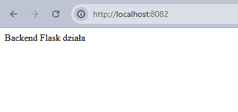

*Rysunek 10. Poprawne uruchomienie aplikacji Flask przez serwer Nginx.*

Następnie sprawdzono połączenie backendu z bazą danych pod adresem `http://localhost:8082/db`. Aplikacja poprawnie połączyła się z PostgreSQL i wyświetliła informacje o jego wersji 16.16.

**Screenshot:**


*Rysunek 11. Poprawne połączenie aplikacji Flask z bazą danych PostgreSQL.*

**Sprawdzenie izolacji sieciowej:**

Wykorzystano polecenie Pythona do sprawdzenia rozpoznawania nazwy bazy, ponieważ obraz `python:3.11-slim` nie posiadał narzędzia `ping`.

**Użyte polecenia:**

```bash
docker compose exec backend python -c "import socket; print(socket.gethostbyname('database'))"

docker compose exec nginx ping -c 2 database
```

**Wynik działania:**

Backend poprawnie rozpoznał bazę danych pod adresem `172.19.0.2`. Natomiast Nginx zwrócił komunikat `ping: bad address 'database'`, ponieważ nie był podłączony do sieci backendowej.

Potwierdziło to poprawną izolację warstw aplikacji. Backend miał dostęp do PostgreSQL, natomiast Nginx nie mógł bezpośrednio odnaleźć bazy danych.

**Screenshot:**

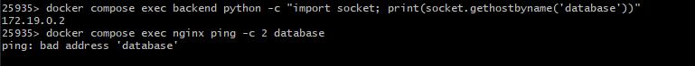

*Rysunek 12. Sprawdzenie komunikacji backendu z bazą oraz izolacji sieciowej Nginx.*


### Zadanie 3 - Round-robin DNS

**Opis:**

Utworzono sieć `round-robin-net` i uruchomiono trzy kontenery Alpine ze wspólnym aliasem sieciowym `serwer`.

Następnie trzykrotnie wykonano zapytanie DNS za pomocą `nslookup`, aby sprawdzić adresy przypisane do tego samego aliasu.

**Użyte polecenia:**

```bash
docker network create round-robin-net

docker run -d --name server1 \
  --network round-robin-net \
  --network-alias serwer \
  alpine sleep 3600

docker run -d --name server2 \
  --network round-robin-net \
  --network-alias serwer \
  alpine sleep 3600

docker run -d --name server3 \
  --network round-robin-net \
  --network-alias serwer \
  alpine sleep 3600

docker run --rm --network round-robin-net alpine nslookup serwer

docker run --rm --network round-robin-net alpine nslookup serwer

docker run --rm --network round-robin-net alpine nslookup serwer
```

**Wynik działania:**

Wszystkie trzy zapytania zwróciły adresy IP `172.19.0.2`, `172.19.0.3` i `172.19.0.4`. Kolejność adresów zmieniała się pomiędzy zapytaniami.

Potwierdziło to, że Docker DNS może zwracać wiele adresów IP dla jednego aliasu sieciowego. Samo rozpoznawanie DNS nie gwarantuje jednak równomiernego rozdzielania rzeczywistych połączeń.

**Screenshot:**

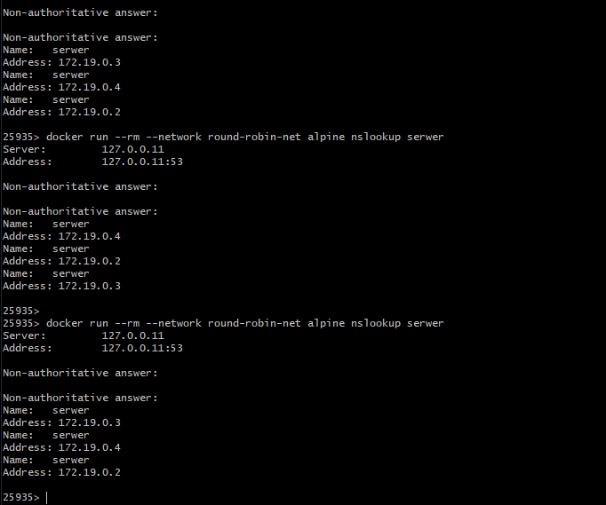

*Rysunek 13. Wyniki trzech zapytań DNS dla wspólnego aliasu serwer.*

Po zakończeniu zadania usunięto kontenery i sieć:

```bash
docker stop server1 server2 server3
docker rm server1 server2 server3
docker network rm round-robin-net
```

## 5. Wnioski

Podczas laboratorium nauczyłam się tworzyć i konfigurować sieci Docker oraz sprawdzać komunikację między kontenerami. Zobaczyłam, jak działa rozpoznawanie nazw przez DNS, mapowanie portów i izolowanie usług w oddzielnych sieciach. Udało mi się również uruchomić architekturę składającą się z Nginx, aplikacji Flask i bazy PostgreSQL. Ćwiczenia pomogły mi lepiej zrozumieć, w jaki sposób kontenery mogą bezpiecznie komunikować się ze sobą.
