# Laboratorium 5 - Docker Compose

**Przedmiot:** Aplikacje w środowisku kontenerowym  
**Temat:** Docker Compose  
**Data wykonania:** 23.11.2026  
**Autor:** Patrycja Teska  
**Numer indeksu:** 25935  
**Grupa:** 235IC, A2

---

## 1. Cel laboratorium

Celem laboratorium było poznanie Docker Compose oraz nauka uruchamiania i zarządzania aplikacjami składającymi się z kilku kontenerów. W trakcie ćwiczeń tworzono pliki konfiguracyjne, uruchamiano usługi, sprawdzano komunikację między kontenerami oraz testowano działanie sieci, wolumenów i zmiennych środowiskowych.

## 2. Wstęp teoretyczny

Docker Compose to narzędzie, które pozwala uruchamiać i zarządzać wieloma kontenerami za pomocą jednego pliku konfiguracyjnego `docker-compose.yaml`. W pliku można określić wykorzystywane obrazy, porty, sieci, wolumeny oraz zmienne środowiskowe.

Dzięki Docker Compose można łatwo uruchomić aplikację składającą się np. z frontendu, backendu i bazy danych, bez konieczności tworzenia każdego kontenera osobno.

---

## 3. Przebieg ćwiczeń

### Ćwiczenie 1.1 - Pierwszy plik Docker Compose

**Opis:**

Utworzono pierwszy plik `docker-compose.yaml` z usługą Nginx. Następnie uruchomiono kontener, sprawdzono jego status oraz działanie serwera WWW.

Serwer udostępniono na porcie 8085, aby uniknąć konfliktu z innymi uruchomionymi aplikacjami.

**Użyte polecenia:**

```bash
docker compose up -d
docker compose ps
docker compose logs
curl http://localhost:8085
docker compose down
```

**Wynik działania:**

Kontener Nginx został poprawnie uruchomiony. Po wykonaniu zapytania na port 8085 otrzymano odpowiedź serwera.

**Screenshot:**

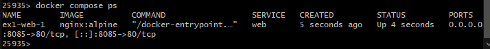

*Rysunek 1. Uruchomienie serwera Nginx za pomocą Docker Compose.*

### Ćwiczenie 1.2 - Uruchomienie wielu usług

**Opis:**

Przygotowano konfigurację zawierającą trzy usługi: Nginx, PostgreSQL oraz Redis. Następnie uruchomiono wszystkie kontenery za pomocą jednego polecenia i sprawdzono ich działanie.

**Użyte polecenia:**

```bash
docker compose up -d
docker compose ps
docker compose logs db
docker compose exec db psql -U postgres -c "SELECT version();"
docker compose down
```

**Wynik działania:**

Wszystkie trzy kontenery zostały uruchomione. Udało się również połączyć z PostgreSQL i sprawdzić wersję bazy danych.

**Screenshot:**

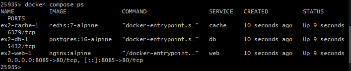

*Rysunek 2. Uruchomienie usług Nginx, PostgreSQL i Redis.*

---

### Ćwiczenie 2.1 - Aplikacja Flask + PostgreSQL

**Opis:**

Przygotowano aplikację Flask połączoną z bazą PostgreSQL. Utworzono pliki `app.py`, `requirements.txt`, `Dockerfile` oraz `docker-compose.yaml`.

Następnie uruchomiono aplikację i sprawdzono działanie przygotowanych endpointów.

**Użyte polecenia:**

```bash
docker compose up -d --build
docker compose ps
curl http://localhost:5000
curl http://localhost:5000/db
curl http://localhost:5000/health
```

**Wynik działania:**

Aplikacja Flask uruchomiła się poprawnie na porcie 5000. Endpoint `/db` potwierdził połączenie z PostgreSQL, a `/health` zwrócił informację o poprawnym działaniu aplikacji.

**Screenshot:**

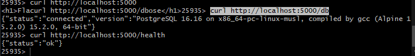

*Rysunek 3. Sprawdzenie działania aplikacji Flask i połączenia z PostgreSQL.*

### Ćwiczenie 2.2 - Panel Adminer

**Opis:**

Do konfiguracji Docker Compose dodano usługę Adminer, która umożliwia zarządzanie bazą danych przez przeglądarkę internetową.

Następnie otwarto panel pod adresem `http://localhost:8085` i zalogowano się do PostgreSQL.

**Wynik działania:**

Udało się uruchomić panel Adminer oraz uzyskać dostęp do bazy danych `myapp`.

**Screenshot:**

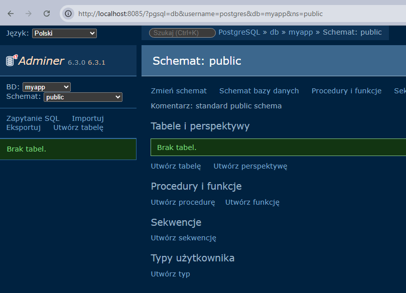

*Rysunek 4. Połączenie z bazą PostgreSQL za pomocą panelu Adminer.*

---

### Ćwiczenie 3.1 - Zmienne środowiskowe z pliku .env

**Opis:**

Utworzono plik `.env`, w którym zapisano ustawienia bazy PostgreSQL oraz port aplikacji. Następnie wykorzystano te zmienne w pliku `docker-compose.yaml`.

Sprawdzono poprawność konfiguracji oraz wykonano zapytanie SQL wyświetlające aktualnego użytkownika i nazwę bazy danych.

**Użyte polecenia:**

```bash
docker compose config
docker compose up -d
docker compose exec db psql -U admin -d production_db -c "SELECT current_user, current_database();"
docker compose down
```

**Wynik działania:**

Zmienne środowiskowe zostały poprawnie odczytane. Zapytanie SQL zwróciło użytkownika `admin` oraz bazę `production_db`.

**Screenshot:**

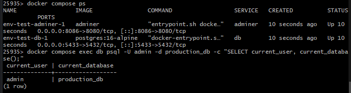

*Rysunek 5. Sprawdzenie konfiguracji PostgreSQL z wykorzystaniem pliku .env.*

---

### Ćwiczenie 4.1 - Izolacja sieciowa

**Opis:**

Utworzono dwie sieci Docker Compose: `frontend` i `backend`.

Kontener aplikacji podłączono do obu sieci, natomiast Nginx do sieci `frontend`, a PostgreSQL do sieci `backend`.

Następnie sprawdzono komunikację między kontenerami za pomocą polecenia `ping`.

**Użyte polecenia:**

```bash
docker compose up -d
docker compose exec app ping -c 2 nginx
docker compose exec app ping -c 2 db
docker compose exec nginx ping -c 2 db
docker compose down
```

**Wynik działania:**

Kontener aplikacji mógł komunikować się zarówno z Nginx, jak i PostgreSQL. Natomiast Nginx nie mógł odnaleźć kontenera bazy danych, co potwierdziło izolację sieciową.

**Screenshot:**

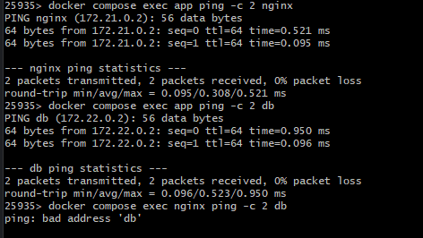

*Rysunek 6. Sprawdzenie komunikacji i izolacji między kontenerami.*

### Ćwiczenie 4.2 - Wolumeny nazwane

**Opis:**

Utworzono wolumen `pgdata` służący do przechowywania danych PostgreSQL. Za pomocą pliku `init.sql` przygotowano tabelę `tasks` z dwoma przykładowymi rekordami.

Następnie usunięto kontener i uruchomiono go ponownie, aby sprawdzić trwałość zapisanych danych.

**Użyte polecenia:**

```bash
docker compose up -d
docker compose exec db psql -U postgres -c "SELECT * FROM tasks;"
docker compose down
docker compose up -d
docker compose exec db psql -U postgres -c "SELECT * FROM tasks;"
docker compose down -v
```

**Wynik działania:**

Po ponownym uruchomieniu kontenera w tabeli nadal znajdowały się dwa rekordy. Potwierdziło to, że dane były przechowywane w wolumenie, a nie wyłącznie w kontenerze.

**Screenshot:**

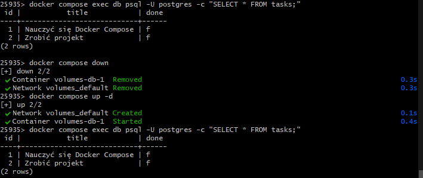

*Rysunek 7. Sprawdzenie trwałości danych PostgreSQL po ponownym uruchomieniu kontenera.*

---

### Ćwiczenie 5 - Komendy Docker Compose

**Opis:**

W tej części wykorzystano wcześniej przygotowaną aplikację Flask. Przetestowano budowanie obrazów, wyświetlanie logów, wykonywanie poleceń wewnątrz kontenerów oraz ich zatrzymywanie i ponowne uruchamianie.

Sprawdzono również skalowanie aplikacji do trzech instancji.

**Użyte polecenia:**

```bash
docker compose build
docker compose build --no-cache app
docker compose up -d --build
docker compose logs -f app
docker compose exec app python -c "print('Hello from app')"
docker compose exec db psql -U postgres -c "SELECT 1;"
docker compose run --rm app python -c "print('One-time command')"
docker compose up -d --scale app=3
docker compose ps
docker compose port --index=2 app 5000
docker compose restart app
docker compose up -d --scale app=1
docker compose stop
docker compose start
docker compose down
docker compose down -v
```

**Wynik działania:**

Udało się wykonać podstawowe i zaawansowane polecenia Docker Compose. Aplikację Flask uruchomiono w trzech kontenerach, którym przypisano osobne porty 5000–5002.

Następnie zmniejszono liczbę instancji do jednej i sprawdzono zarządzanie cyklem życia kontenerów.

**Screenshot:**

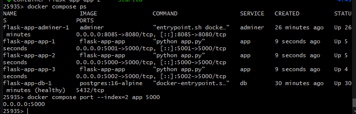

*Rysunek 8. Skalowanie aplikacji Flask do trzech kontenerów i sprawdzenie przypisanych portów.*

---

### Ćwiczenie 6 - depends_on i healthcheck

**Opis:**

Przygotowano konfigurację zawierającą aplikację, PostgreSQL oraz Redis. Dodano mechanizmy `healthcheck` i `depends_on`, aby aplikacja uruchamiała się dopiero po osiągnięciu gotowości przez pozostałe usługi.

**Użyte polecenia:**

```bash
docker compose up -d
docker compose ps
docker compose logs app
docker compose down
```

**Wynik działania:**

PostgreSQL i Redis uzyskały status `healthy`, a aplikacja została poprawnie uruchomiona. W logach wyświetlono komunikat potwierdzający jej uruchomienie.

**Screenshot:**

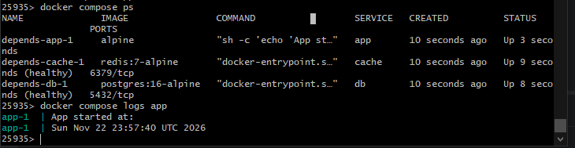

*Rysunek 8. Sprawdzenie statusów kontenerów i uruchomienia aplikacji.*

---

### Ćwiczenie 7.2 - Node.js + MongoDB


**Opis:**

Uruchomiono przykładową aplikację Node.js współpracującą z bazą MongoDB. Dodatkowo uruchomiono panel Mongo Express umożliwiający przeglądanie danych.

Przetestowano dodawanie i wyświetlanie zadań w aplikacji.

**Użyte polecenia:**

```bash
docker compose up -d --build
docker compose ps
docker compose logs
docker compose down
```

**Wynik działania:**

Aplikacja uruchomiła się poprawnie na porcie 3000. Udało się dodać przykładowe zadanie, które zostało wyświetlone na stronie.

**Screenshot:**

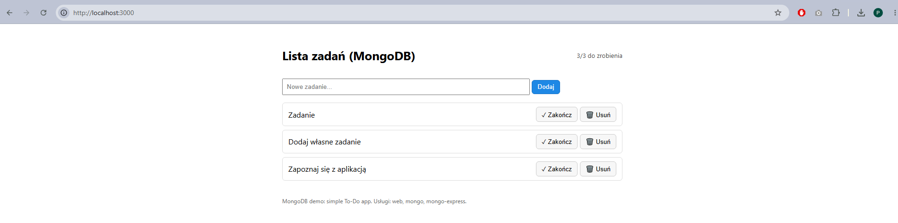

*Rysunek 9. Działanie aplikacji do zarządzania zadaniami z wykorzystaniem MongoDB.*

---

## 4. Zadania samodzielne

### Zadanie 1 - WordPress + MySQL

**Opis:**

Przygotowano plik `docker-compose.yaml` uruchamiający WordPress oraz bazę MySQL. Dodano wolumeny służące do przechowywania danych aplikacji i bazy.

Następnie uruchomiono kontenery i sprawdzono dostępność WordPressa w przeglądarce.

**Użyte polecenia:**

```bash
docker compose config -q
docker compose up -d
docker compose ps
docker compose down
```

**Wynik działania:**

Oba kontenery zostały poprawnie uruchomione. Po otwarciu adresu `http://localhost:8089` wyświetliła się strona instalacyjna WordPressa.

**Screenshoty:**

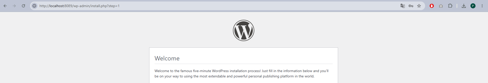

*Rysunek 10. Uruchomienie strony instalacyjnej WordPressa.*

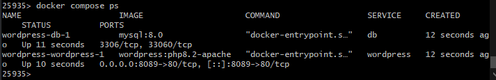

*Rysunek 11. Sprawdzenie działania kontenerów WordPress i MySQL.*

### Zadanie 2 - Aplikacja MERN

**Opis:**

Przygotowano prostą aplikację MERN składającą się z trzech usług:

- MongoDB - baza danych,
- Express i Node.js - backend,
- React - frontend.

Backend udostępniał endpoint `/api/status`, który zwracał informacje o działaniu aplikacji i połączeniu z MongoDB.

Frontend React pobierał te informacje i wyświetlał je na stronie.

**Użyte polecenia:**

```bash
docker compose config -q
docker compose up -d --build
docker compose ps
docker compose down
```

**Wynik działania:**

Udało się uruchomić wszystkie trzy kontenery. Po otwarciu strony `http://localhost:5173` wyświetliły się komunikaty potwierdzające działanie Reacta, backendu Express oraz połączenia z MongoDB.

**Screenshoty:**

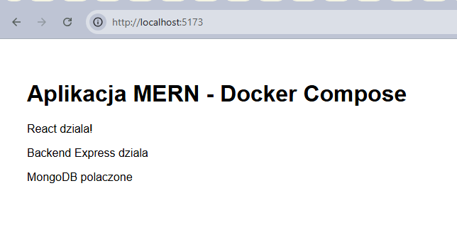

*Rysunek 12. Sprawdzenie działania aplikacji MERN w przeglądarce.*

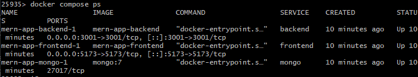

*Rysunek 13. Uruchomione kontenery MongoDB, Express i React.*

### Zadanie 3 - Override files

**Opis:**

Do aplikacji MERN dodano plik `docker-compose.override.yaml` z ustawieniami środowiska developerskiego.

Wykorzystano bind mounty, aby pliki backendu i frontendu były dostępne bezpośrednio w kontenerach.

Następnie zmieniono tekst w pliku `src.jsx` i sprawdzono, czy zmiana jest widoczna w kontenerze oraz w przeglądarce.

**Użyte polecenia:**

```bash
docker compose config -q
docker compose up -d --build
docker compose ps
MSYS_NO_PATHCONV=1 docker compose exec frontend cat /app/src.jsx
docker compose restart frontend
docker compose down
```

**Wynik działania:**

Zmodyfikowany plik React był widoczny wewnątrz kontenera. Po odświeżeniu aplikacji wyświetlił się nowy komunikat „React dziala w trybie developerskim”.

Potwierdziło to poprawne działanie bind mountów bez konieczności ponownego budowania obrazu.

**Screenshot:**

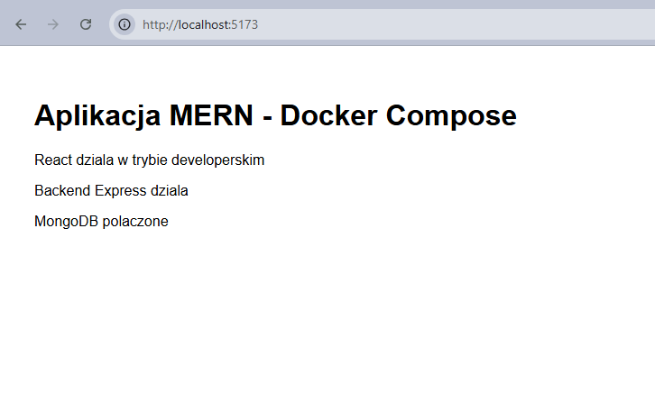

*Rysunek 14. Sprawdzenie działania aplikacji React po zmianie kodu w trybie developerskim.*

---

## 5. Wnioski

Podczas laboratorium nauczyłam się korzystać z Docker Compose do uruchamiania kilku kontenerów jednocześnie. Przećwiczyłam konfigurację sieci, wolumenów i zmiennych środowiskowych oraz sprawdzanie działania usług za pomocą healthcheck.

Najbardziej przydatne było uruchamianie aplikacji składających się z frontendu, backendu i bazy danych.
